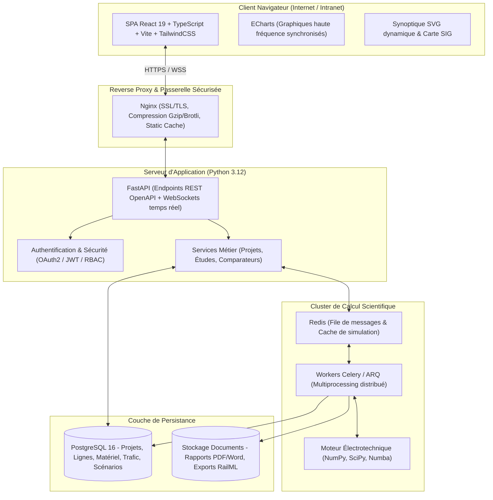

# SimTraction Pro – Spécifications Techniques & Architecture

Ce document détaille l'état de l'art du logiciel existant (**SimTraction V1**), l'analyse de ses limites, l'architecture cible Full-Stack de **SimTraction Pro**, ainsi que l'ensemble des améliorations électrotechniques et logicielles pour un déploiement serveur professionnel accessible par navigateur externe via Internet.

---

## 1. Analyse Approfondie de SimTraction V1

SimTraction V1 est un outil mono-page (`SimTraction.html`, 3 466 lignes de JavaScript) utilisant l'API locale *File System Access* pour interagir avec des fichiers CSV structurés dans un dossier `BDD/`. Le noyau algorithmique dérive d'un moteur Python originel validé par rapport au logiciel de référence **RailPower**.

### 1.1 Systèmes d'électrification pris en compte
* **3 kV continu (CC)** :
  * Sous-stations modélisées par des groupes transformateur-redresseur à diodes (tension à vide $U_0$, résistance interne $R_{int}$, conduction unidirectionnelle sans réversibilité).
  * Ligne de contact : résistance caténaire $R_{cat}$ par voie, résistance des rails $R_{rail}$ et conductance de fuite rail-sol $G_{rail-terre}$.
  * Postes de sectionnement et de mise en parallèle des voies (**PS**) réduisant les chutes de tension ohmiques.
* **1×25 kV 50 Hz (CA)** :
  * Sous-stations à transformateur monophasé raccordé entre deux phases du réseau HT (impédance équivalente Thévenin calculée à partir du court-circuit réseau $S_{cc}$ et de la tension de court-circuit transformateur $U_{cc}$).
  * Postes de sectionnement (**SP**) avec zones neutres et postes de mise en parallèle (**SSP**).
* **2×25 kV 50 Hz (CA)** :
  * Système à autotransformateurs (**AT**) répartis (typiquement tous les 10 à 15 km).
  * Caténaire portée à $+25\text{ kV}$, feeder porté à $-25\text{ kV}$ par rapport au rail.
  * Matrice d'admittance complexe $2 \times 2$ prenant en compte les impédances propres et la mutuelle caténaire-feeder $Z_{cf}$.

### 1.2 Modélisation cinématique et dynamique
* **Résistance à l'avancement** selon la formule de Davis :
  $$R(v) = (A + B\cdot v + C\cdot v^2) \cdot (1 + \text{tunnel})$$
* **Efforts géométriques** :
  * Résistance de rampe/pente : $F_{pente} = m \cdot g \cdot p / 1000$ (avec $p$ en ‰).
  * Résistance de courbe : $F_{courbe} = C_{courbe} / R$ (avec $R$ rayon en m).
* **Matériel roulant** :
  * Modèle `serie_cc` : Moteur continu à excitation série régulé par hacheur (coefficients constructeur $c_2, c_3$ calibrés sur le parc ONCF).
  * Modèle `tabule` : Engins modernes asynchrones/synchrones à chaîne de traction triphasée (effort maximal $F_{max}$, puissance maximale jante $P_{max}$, rendement chaîne $\eta$, auxiliaires $P_{aux}$, facteur de puissance $\cos \phi$).
  * Réduction de puissance en sous-tension conforme à l'**EN 50388-1** : limitation linéaire entre $U_{lim\_haut}$ et $U_{lim\_bas}$.
* **Marche des trains** :
  * Résolution pas à pas (1 à 5 s) intégrant les enveloppes de freinage rétrogrades pour le respect des arrêts en gare et des ralentissements, avec prise en compte du dégagement de la queue du train.

### 1.3 Solveur électrique et dimensionnement
* Solveur nodal spécialisé à matrice bande (`BandR` en réel pour le continu, `BandC` en complexe pour l'alternatif) résolu en $\mathcal{O}(n \cdot w^2)$.
* Itérations à puissance constante pour chaque circulation avec mise à jour du point de fonctionnement des diodes de sous-station.
* Module de dimensionnement automatique des sous-stations par algorithme glouton (recherche de l'espacement optimal, ajout de sous-stations au point de tension le plus faible, élagage des postes superflus et comparaison des puissances unitaires normalisées).
* Vérification des situations dégradées **N-1** (perte unitaire d'une sous-station avec fermeture des sections neutres ou pontage).

### 1.4 Projets et données de référence inclus
La base de données contient **14 projets réels et d'essai** :
* Lignes du réseau marocain ONCF (3 kV CC) : *Ain Sebaa – Kenitra* (axe principal 121 km, 6 sous-stations), *Casa Voyageurs – Bouskoura*, *Bouskoura – Aéroport*, *Casa Port*, etc.
* Lignes nouvelles d'essai 25 kV et 2×25 kV (150 km, circulation grande vitesse à 320 km/h).
* Bibliothèque de matériel roulant (TNR ZM 9000, TVRR E1300, E1250, TMR E1100, Rame GV 25 kV, automotrices régionales).

---

## 2. Limites Actuelles et Justification de la Version Pro

| Axe d'analyse | Version Actuelle (SimTraction V1) | Version Professionnelle (SimTraction Pro) |
| :--- | :--- | :--- |
| **Architecture** | Client-side unique dans le navigateur, calculs exécutés en JavaScript local, pas de serveur. | **Architecture client-serveur Full-Stack**, séparation stricte IHM / Logique métier / Base de données. |
| **Accès & Déploiement** | Fichier HTML local utilisant `window.showDirectoryPicker` (incompatible avec un accès distant, mobile ou navigateurs Firefox/Safari). | **Application Web SaaS déployable sur serveur (Docker)**, accessible par URL HTTPS sur tout navigateur moderne sans installation. |
| **Gestion des données** | Fichiers CSV locaux sans contrôle de concurrence (risque d'écrasement mutuel en réseau partagé). | **Base de données relationnelle PostgreSQL**, contrôle d'accès multi-utilisateurs (RBAC), historique des révisions. |
| **Calculs intensifs** | Bloqué par les limites de mémoire du navigateur et le single-thread JavaScript. | **Moteur de calcul scientifique Python vectorisé (NumPy/SciPy/Numba)** avec files asynchrones (**Celery + Redis**). |
| **Topologie ferroviaire** | Uniquement linéaire 1D (un axe PK continu). | **Graphe de réseau ferroviaire 2D/3D** (bifurcations, maillages, évitements, raccordements). |
| **Sous-stations modernes** | Diodes simples uniquement, énergie de freinage dissipée dans les rhéostats. | **Sous-stations réversibles (onduleurs)** et **systèmes de stockage d'énergie stationnaires (BESS)**. |
| **Ligne de contact** | Résistances statiques forfaitaires. | **Calcul thermique des conducteurs caténaire ($I^2 t$)** et matrice multi-conducteurs Carson-Clem. |
| **Reporting** | Fichier HTML exporté avec extension `.doc`. | **Générateur de notes de calcul professionnelles** aux formats **PDF haute résolution** et **Word `.docx` structuré**. |

---

## 3. Architecture Système Cible (SimTraction Pro)

---

## 4. Spécifications des Améliorations Métier & Techniques

### 4.1 Améliorations du Génie Électrique Ferroviaire
1. **Topologie Réseau Maillée & Bifurcations** :
   * Modélisation par graphe de nœuds et branches permettant de représenter les nœuds ferroviaires complexes (gares centrales, triangles de raccordement, doublement d'antennes).
2. **Sous-stations Réversibles (Onduleurs de récupération)** :
   * Prise en compte des sous-stations modernes permettant la réinjection du surplus de freinage régénératif sur le réseau HT du gestionnaire d'électricité (réduction drastique de la facture énergétique globale).
3. **Systèmes de Stockage d'Énergie Stationnaires (BESS)** :
   * Modélisation de batteries tampons ou supercondensateurs implantés en ligne pour soutenir la tension en bout d'antenne sans construire de sous-station HT complète.
4. **Calcul Thermique Caténaire (Normes EN 50149 / CEI 60865)** :
   * Suivi de la température des conducteurs caténaire et porteur sous sollicitation cyclique selon le bilan thermique (échauffement Joule vs convection/rayonnement ambiant).
5. **Modélisation Multi-conducteurs Carson-Clem (25 kV & 2×25 kV)** :
   * Formulation analytique de la matrice complète des impédances linéiques propres et mutuelles entre fil de contact, câble porteur, feeder, rails et câbles de terre aériens.
6. **Modulation de la tension à vide & Réseau HT amont dynamique** :
   * Prise en compte de la chute de tension dynamique sur le réseau amont selon la puissance appelée et l'impédance de court-circuit locale.

### 4.2 Améliorations de l'Ingénierie Logicielle
1. **Architecture Multi-locataire & Collaboration** :
   * Gestion des utilisateurs, permissions (Administrateur, Ingénieur d'études, Lecteur/Auditeur), gestion des projets par études et variantes.
2. **Calcul Distribué Asynchrone** :
   * Les calculs lourds (simulations 24h, N-1 combinatoire, dimensionnement de parcs) s'exécutent en arrière-plan sans bloquer l'interface.
   * Suivi pas-à-pas de l'avancement via WebSockets avec affichage des métriques intermédiaires et streaming des logs.
3. **Visualisation Interactive Haute Performance** :
   * Graphiques scientifiques haute fréquence avec **Apache ECharts** : zoom temporel fluide, curseur unifié reliant simultanément position du train, tension au pantographe et appel de puissance en sous-station.
   * Schéma unifilaire interactif animé : visualisation de la progression des trains et des flux de courant en temps réel.
4. **Moteur d'Édition de Notes de Calcul Professionnelles** :
   * Génération automatique de rapports complets au format **PDF certifié** (via Jinja2/WeasyPrint) avec mise en page normalisée, graphiques vectoriels intégrés, tableaux de conformité et annexes d'ingénierie.
   * Export au format **Word (.docx)** éditable basé sur des modèles chartés.
5. **Interopérabilité & Échange de Données** :
   * Rétrocompatibilité totale avec les fichiers CSV et classeurs Excel de SimTraction V1.
   * Support de l'import/export **RailML** et export SIG (**GeoJSON**).

---

## 5. Synthèse des Bénéfices de SimTraction Pro

* **Déploiement Clé en Main** : Déploiement en une seule commande via Docker (`docker compose up -d`) sur n'importe quel serveur Linux/Windows Server/Cloud.
* **Accessibilité Totale** : Utilisation instantanée depuis n'importe quel navigateur externe via Internet sans installation locale ni restrictions de sécurité disque.
* **Puissance de Calcul Industrielle** : Temps d'exécution divisé par 10 à 50 grâce à la vectorisation Python/SciPy.
* **Sécurité & Intégrité** : Centralisation des données dans PostgreSQL avec sauvegardes automatiques et gestion fine des habilitations.
