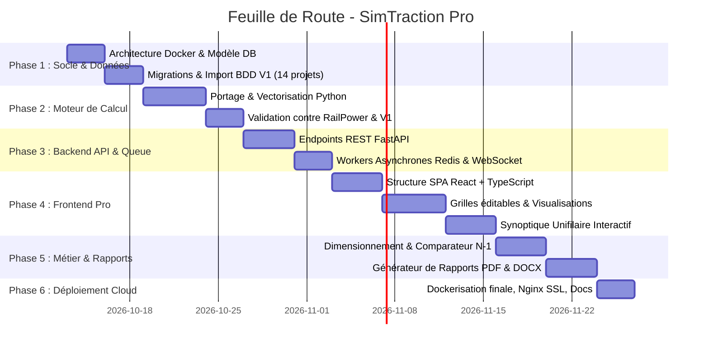

# Plan de Réalisation – SimTraction Pro

Ce document constitue la feuille de route opérationnelle étape par étape pour concevoir, développer, tester et déployer le logiciel professionnel d'étude de puissance ferroviaire **SimTraction Pro**.

---

## Vue d'Ensemble des Jalons



---

## Phase 1 : Initialisation de l'Environnement et Modèle de Données

### 1.1 Objectifs
Mettre en place l'infrastructure logicielle, la conteneurisation Docker de développement et le schéma de base de données relationnelle PostgreSQL.

### 1.2 Tâches Détaillées
* **Structure du Répertoire** :
  ```text
  SimTraction/
  ├── docker-compose.yml
  ├── docker-compose.prod.yml
  ├── .env.example
  ├── backend/
  │   ├── app/
  │   │   ├── api/          # Routeurs REST et WebSockets
  │   │   ├── core/         # Configuration, sécurité, logging
  │   │   ├── models/       # Modèles ORM SQLAlchemy
  │   │   ├── schemas/      # Schémas de validation Pydantic
  │   │   ├── physics/      # Moteur de calcul scientifique
  │   │   ├── services/     # Logique applicative
  │   │   └── tasks/        # Tâches asynchrones Celery
  │   ├── Dockerfile
  │   └── requirements.txt
  └── frontend/
      ├── src/
      │   ├── components/   # Composants UI réutilisables
      │   ├── pages/        # Vues principales du simulateur
      │   ├── services/     # Client API Axios & WebSocket
      │   ├── types/        # Définitions TypeScript
      │   └── utils/        # Aides de calcul et formattage
      ├── Dockerfile
      └── package.json
  ```
* **Conception du Schéma PostgreSQL (SQLAlchemy + Alembic)** :
  * `organisations` & `users` (multi-locataire, gestion des droits).
  * `projects` : Métadonnées, paramètres d'électrification (`cc3000`, `ac1x25`, `ac2x25`), durées, marges.
  * `track_sections` : Tronçons de ligne (PK début, PK fin, déclivité, rayon, vitesse limite, gare, tunnel).
  * `rolling_stock` : Bibliothèque d'engins moteurs et matériels roulants du projet (série CC, tabulés).
  * `timetables` : Grille horaire des circulations (sens, heure de départ, voie, arrêts).
  * `substations` & `switching_stations` : Sous-stations de traction ($U_0, R_{int}, S_n, U_{cc}, S_{cc}$) et postes (PS, SP, SSP, ATS).
  * `simulation_runs` & `simulation_results` : Historique des calculs, KPIs globaux, séries temporelles et analyses de conformité.
* **Script de Migration & Rétrocompatibilité V1** :
  * Développer un parseur pour importer automatiquement l'intégralité de la base V1 (`BDD/projets/`, `materiel.csv`, `sites_ht.csv`, `parametres/`) dans PostgreSQL.

---

## Phase 2 : Moteur de Calcul Scientifique Python Vectorisé

### 2.1 Objectifs
Convertir le moteur de simulation de JavaScript vers Python en exploitant les bibliothèques scientifiques de référence (`numpy`, `scipy.sparse`, `numba`) pour obtenir des performances industrielles.

### 2.2 Tâches Détaillées
* **Module Cinématique (`cinematics.py`)** :
  * Résolution de l'équation différentielle de mouvement du train :
    $$m_{dyn} \frac{dv}{dt} = F_{jante}(v, U) - R_{davis}(v) - F_{pente} - F_{courbe}$$
  * Calcul prédictif des enveloppes de décélération pour chaque arrêt programmé et limitation de vitesse.
* **Module Électrique 3 kV Continu (`solver_dc.py`)** :
  * Construction de la matrice nodale en bande de conductance $G$.
  * Algorithme itératif non-linéaire avec prise en compte des diodes de roue libre (coupure en cas de courant négatif).
  * Calcul des potentiels de rail $V_{rail}$ et fuites à la terre.
* **Module Électrique 1×25 kV et 2×25 kV Alternatif (`solver_ac.py`)** :
  * Résolution nodale en régime sinusoïdal complexe $\underline{Y} \cdot \underline{V} = \underline{I}$.
  * Modélisation Thévenin des sous-stations et prise en compte des impédances mutuelles caténaire-feeder et des autotransformateurs.
  * Réduction de puissance en basse tension selon l'**EN 50388-1**.
* **Validation & Non-Régression** :
  * Écriture d'une suite de tests unitaires (Pytest) comparant les résultats numériques du nouveau moteur Python à ceux de SimTraction V1 sur le projet étalon *Ain Sebaa – Kenitra*. Écart relatif cible : $< 0,05\%$.

---

## Phase 3 : Backend API REST & Moteur de Calcul Asynchrone

### 3.1 Objectifs
Exposer l'ensemble des fonctionnalités via une API REST sécurisée, performante et documentée, capable d'exécuter des simulations lourdes en tâche de fond.

### 3.2 Tâches Détaillées
* **Endpoints API REST (FastAPI)** :
  * `/api/projects` : CRUD projets et duplication en variantes.
  * `/api/projects/{id}/alignment` : Gestion du profil en long et des gares.
  * `/api/projects/{id}/rolling-stock` : Association des engins depuis la bibliothèque.
  * `/api/projects/{id}/timetable` : Grille de trafic, générateur de cadencement automatique.
  * `/api/projects/{id}/power-supply` : Configuration de l'électrification, sous-stations, postes.
  * `/api/simulations/run` : Lancement d'une simulation (normale ou N-1).
  * `/api/simulations/{id}/results` : Récupération des résultats agrégés, KPIs et séries temporelles.
  * `/api/dimensioning/run` : Lancement de l'optimisation automatique des implantations.
* **File de Calcul Asynchrone (Celery + Redis)** :
  * Gestionnaire de tâches capable de paralléliser les simulations des différents scénarios N-1.
  * Canaux **WebSockets** pour transmettre la progression en pourcentage ($0 \rightarrow 100\%$) et les messages de journalisation en direct vers le navigateur.

---

## Phase 4 : Frontend Web Moderne & Interface Interactive

### 4.1 Objectifs
Créer une interface utilisateur web professionnelle, réactive et ergonomique, digne des outils de simulation de pointe.

### 4.2 Tâches Détaillées
* **Architecture de l'Application Client** :
  * SPA développée en **React 19**, **TypeScript** et propulsée par **Vite**.
  * Design System soigné avec **TailwindCSS** (typographie technique moderne, palette harmonieuse, thème clair/sombre, respect de l'accessibilité).
* **Composants Clés de l'Interface** :
  * **Tableaux Éditables Intelligents** : Grilles fluides avec prise en charge native du copier-coller bidirectionnel avec Microsoft Excel.
  * **Visualisation Graphique Haute Performance (Apache ECharts)** :
    * Profil en long et limitations de vitesse.
    * Courbes d'effort et caractéristiques de traction des engins.
    * Graphique de circulation espace-temps ($PK = f(t)$).
    * Tensions au pantographe le long de la ligne avec seuils normatifs EN 50163.
    * Appels de puissance des sous-stations et courants de départ.
  * **Schéma Unifilaire & Synoptique Dynamique (SVG Interactif)** :
    * Visualisation vectorielle de l'infrastructure électrique.
    * Mode *Playback* : animation interactive de la progression des trains sur la ligne et des flux de puissance en temps réel.

---

## Phase 5 : Dimensionnement Automatique & Générateur de Rapports

### 5.1 Objectifs
Intégrer les algorithmes d'optimisation d'implantation de sous-stations et concevoir le moteur d'édition de notes de calcul automatisées.

### 5.2 Tâches Détaillées
* **Module de Dimensionnement & Comparaison de Variantes** :
  * Algorithme d'optimisation automatique de l'implantation des sous-stations en situation normale et dégradée N-1.
  * Matrice de comparaison des puissances unitaires (ex: comparer 3 MW vs 6 MW en CC, ou 20 MVA vs 40 MVA en CA).
* **Générateur de Rapports d'Ingénierie** :
  * **Export PDF Haute Définition** : Rendu via templates HTML/CSS d'ingénierie compilés en PDF avec en-têtes officiels, sommaire, graphiques vectoriels, tableaux de conformité normatifs et signatures.
  * **Export Word (.docx)** : Génération de classeurs complets éditables structurés par chapitres via `python-docx`.
  * **Export Excel (.xlsx)** : Export du classeur d'étude complet (8 feuilles de données d'entrée et de sortie).

---

## Phase 6 : Déploiement Serveur & Mise en Production

### 6.1 Objectifs
Préparer le package de déploiement conteneurisé prêt pour une mise en ligne sur serveur d'entreprise ou VPS distant avec accès sécurisé via Internet.

### 6.2 Tâches Détaillées
* **Orchestration Docker Compose de Production** :
  * `nginx` : Serveur web frontal avec terminaison SSL/TLS (Let's Encrypt / Certbot), redirection HTTPS, compression Brotli/Gzip et gestion des WebSockets.
  * `frontend` : Conteneur de build servant les assets statiques compilés et optimisés.
  * `backend` : Conteneur FastAPI géré par Uvicorn/Gunicorn.
  * `worker` : Conteneur de calcul Celery pour les tâches asynchrones.
  * `redis` : Cache mémoire et broker de messages.
  * `postgres` : Base de données avec volumes persistants et scripts de sauvegarde automatique.
* **Sécurité & Bonnes Pratiques** :
  * Variables d'environnement externalisées (`.env`).
  * Limitation de débit d'API (*Rate limiting*), en-têtes de sécurité HTTP (HSTS, CSP).
* **Documentation & Procédures d'Exploitation** :
  * Guide d'installation rapide en une seule commande (`docker compose up -d`).
  * Procédure de sauvegarde et restauration de la base de données.
  * Manuel utilisateur avec guide méthodologique des études d'alimentation de traction.
